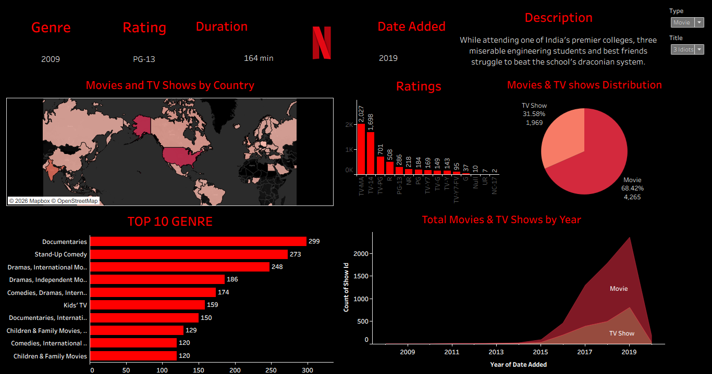

# Netflix Content Analysis — Tableau Dashboard

An interactive Tableau dashboard analysing 6,234 Netflix titles (movies and TV shows) to understand what kind of content dominates the catalogue, where it comes from, and how the library has grown over time.

🔗 **Live dashboard:** [View on Tableau Public](TABLEAU_PUBLIC_LINK_HERE)



---

## Problem statement

Netflix's content catalogue has grown rapidly over the last decade. Using the publicly available Netflix titles dataset, this project answers:

1. What share of the catalogue is Movies vs TV Shows?
2. Which countries produce the most content on Netflix?
3. What audience is the content aimed at (maturity ratings)?
4. Which genres have the most titles?
5. How has the catalogue grown year by year, and has the Movie/TV mix changed?
6. Can a user quickly look up the details of any single title?

## Key findings

- **Movies dominate:** 4,265 movies (68.4%) vs 1,969 TV shows (31.6%).
- **US-centric catalogue:** United States leads with 2,032 titles, followed by India (777), United Kingdom (348), Japan (176) and Canada (141).
- **Adult-oriented content:** TV-MA (2,027) and TV-14 (1,698) together account for about 60% of all titles. Kids' ratings are a small tail.
- **Documentaries and stand-up lead by genre:** Documentaries (299) and Stand-Up Comedy (273) are the two most common single-genre categories; international content appears in most of the top 10.
- **Explosive growth from 2016:** titles added per year went from 412 (2016) → 1,184 (2017) → 1,629 (2018) → 2,057 (2019). The 2020 figure is low only because the dataset ends in January 2020.

## Dashboard components

| # | Chart | Question it answers | Chart type | Fields used |
|---|-------|---------------------|------------|-------------|
| 1 | Movies & TV Shows Distribution | Share of movies vs TV shows | Pie chart | `Type` (colour), `COUNT(show_id)` (angle), % of total label |
| 2 | Movies and TV Shows by Country | Which countries produce the most content | Filled map | `Country` (geographic role), `COUNTD(show_id)` (colour, sequential palette) |
| 3 | Ratings | Which maturity ratings are most common | Bar chart (sorted) | `Rating` (columns), `COUNT(show_id)` (rows) |
| 4 | Top 10 Genre | Which genres have the most titles | Horizontal bar chart | `listed_in` (rows), `COUNTD(show_id)` (columns), Top N filter |
| 5 | Total Movies & TV Shows by Year | Catalogue growth over time and Movie/TV mix | Stacked area chart | `YEAR(date_added)` (columns), `COUNT(show_id)` (rows), `Type` (colour) |
| 6 | Title lookup cards | Details of any single title | Single-value text cards | `Rating`, `Duration`, `YEAR(date_added)`, `Description`, driven by `Type` and `Title` filters |

A detailed per-chart explanation (why each chart type was chosen and what it shows) is in [`docs/analysis.md`](docs/analysis.md).

## Skills demonstrated

- Pie chart with **% of total** quick table calculation
- **Geographic roles** and filled maps with a sequential colour palette
- **Top N filters** by a measure (`COUNTD`)
- Sorted bar charts with cleaned-up axes and labels
- **Area charts** over a continuous date field with null handling
- Single-value KPI/text cards driven by dashboard filters
- Linked filters using **"Only relevant values"**
- Dashboard layout, dark theme and consistent branding

## Limitations

- The `country` and `listed_in` columns hold comma-separated values (e.g. `"United States, India"` or `"Dramas, International Movies"`). The current dashboard treats each combined string as one category, so co-productions and multi-genre titles are undercounted. Splitting these fields with a calculated field or pivot would give a more accurate per-country and per-genre count — this is the planned next iteration.
- The dataset ends in January 2020, so the 2020 bar in the growth chart is not a full year.

## Learning notes

This is a learning project built while studying Tableau. The starting point was a YouTube tutorial on building a Netflix dashboard; I rebuilt it, worked through why each chart type fits its question, documented the findings, and identified the data-quality limitations above. It is not intended to represent original research.

## Repository structure

```
netflix-tableau-dashboard/
├── README.md
├── dashboard/
│   └── Tableau_dashboard_NETFLXI.twb   # Tableau workbook (XML)
├── data/
│   └── netflix_titles.csv              # source dataset
├── docs/
│   └── analysis.md                     # per-chart problem statements and explanations
└── images/
    └── dashboard.png                   # dashboard screenshot
```

## Data source

Netflix Movies and TV Shows dataset (Kaggle, by Shivam Bansal), 6,234 rows, 12 columns. Used for educational purposes.

## Tools

Tableau Public 2026.3
